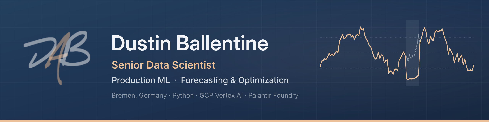

## What I do
I build machine learning and optimization systems and keep them running in production, where the output drives real operational decisions.

## What I've done
For four years at Torqata / American Tire Distributors I owned problems end to end, from problem framing through deployment and monitoring, on GCP Vertex AI and Palantir Foundry:
 
- **Inventory rebalancing optimizer** in daily production since Dec 2024: wrote the multi-objective production formulation, owned the production code and test suite; Dockerized solver → GitHub Actions → Foundry.
- **Stockout / missed-sales imputation** for ~60,000 of 1.8M demand series, each with its own model selected by adaptive cross-validation, stabilized with hysteresis; 80–85% of series beat the moving average they replaced.
- **Platform and MLOps** for the team's ~15 Vertex AI pipelines: CI/CD, dependency-update standard, containers, alerting.
- **~15 Oracle PL/SQL packages → PySpark** in Foundry in three weeks against an eight-week estimate, using agent skills I built on the Palantir MCP.

Before data science: eight years as a US Army engineer officer, including command of a 124-person airborne engineer company.

## How I do it
**Tools I use regularly:** Python (Polars, PySpark, pandas, scikit-learn, statsforecast) · SQL · PuLP / Hexaly · GCP (Vertex AI, BigQuery, Dataproc) · Palantir Foundry · Docker · GitHub Actions · Terraform · AI-assisted development (Claude Code, agent skills, MCP)

## Where I do it
Based near Bremen, Germany. English native, German fluent. Open to senior and lead data science roles in northern Germany or remote.

## Why I do it
I dislike waste. The most expensive kind I see in data science is the model that goes “to prod” once, from a notebook nobody can rebuild, and is never monitored or improved again. I build the other kind: systems that live in version control, deploy through CI/CD, scale with the load, and alert on themselves before the business notices. Systems the next person can audit, maintain and trust.

📫 [LinkedIn](https://www.linkedin.com/in/DABallentine) · dustin.ballentine@gmail.com
 
<!-- Add once public: a "Featured" line linking dab-utils (personal DS toolkit), and later the Foundry deployment pipeline demo. -->
